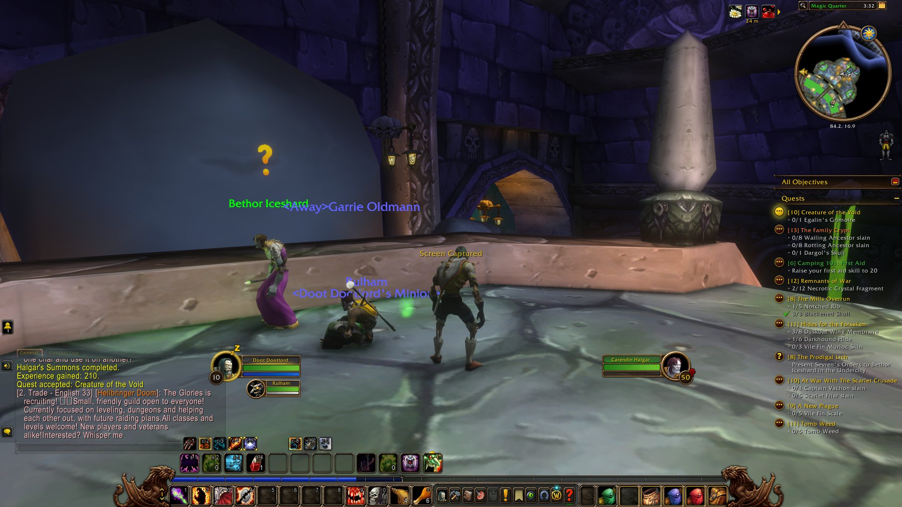
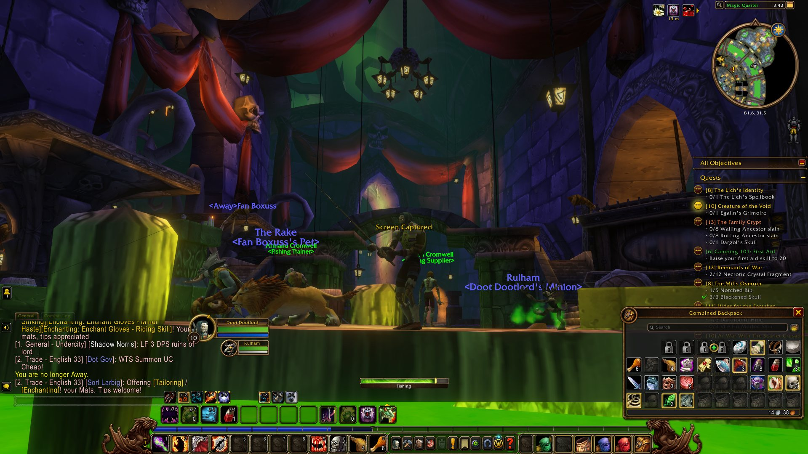

WoW Forever. Oh my god, it's really good.

I'm a big fan of it. Not just because it brings back that old-school MMO vibe I've been looking for, but because it seems to understand *why* that vibe was so good in the first place. It's something I don't think you see nearly enough nowadays.

It really pulls on the old heartstrings of what an MMO **should** be, at least in my eyes.

## An MMO shouldn't just be a gear treadmill

Don't get me wrong, I enjoy getting better gear. Seeing the numbers go up, finding the latest shiny thing and working towards the next upgrade is fun. There's nothing inherently wrong with that.

But I don't think that should be the *point* of an MMO.

You can chase bigger numbers in a single-player game. You can kill bosses and collect loot in a co-op game with friends. What makes an MMO different is that you're part of a world that's greater than yourself.

You're not really the main character.

I appreciate that World of Warcraft has always been a bit of a theme-park MMO, so you're *slightly* the main character. But, really, you're still just one person in this massive world, and that's where so much of the magic comes from.

It's about having a role in that world. Learning things, becoming better at what you do and finding ways to contribute that don't just involve killing the next thing with a health bar.

## Actually having a place in the world

One of the things I'm enjoying most about WoW Forever is how much value there is in the smaller stuff.

I can put down a campfire. I can use my professions to interact with people and the world around me. I can go fishing and potentially find something rare that's genuinely useful to someone on the auction house.

I can go looking for some obscure mob because it might drop something incredibly niche, whether that's for a quest hand-in or a profession that lets someone make a really nice piece of gear.

None of that sounds particularly groundbreaking when you write it down. And, to be fair, it isn't. These are things MMOs have been doing for years.

But that's kind of my point. Somewhere along the way, a lot of games started boiling the experience down to killing things, dodging attacks and getting armour that glows a bit more than the last set.

Those systems can be fun, but when they're practically the *entire* experience, you lose a lot of the charm and novelty.

What I want is that feeling of being part of a living world. A world where people have different skills, need different things and can actually help each other in ways that go deeper than, "Let's kill the next boss."

Ironically, WoW Forever makes me feel more like I'm actually in the **World** of Warcraft.

## I'll admit, I wasn't convinced at first

I'm currently level 10 on an Undead Warlock, to absolutely nobody's surprise.

And it's been an incredible experience so far. But I wasn't sold immediately.

At around level four or five, I genuinely wondered if this was for me. Everything felt *very* slow. I barely had any abilities, combat was a bit brain-dead, and I was sitting there thinking, "Okay, is this really what I want?"

Then things started coming together.

A few more abilities worked their way into my rotation. I got my summon. I started unlocking more of the things that actually make a Warlock feel like a Warlock. Now that I've hit level 10, I'm getting into Soulstones and remembering all the interesting things I can do with them.

And suddenly, it's clicked.

I'm not just a character that happens to have a purple spell effect. I'm starting to feel like I'm **playing a role in my role-playing game**.

That's a really cool feeling, especially when you can share that experience with other people in an online world.

## Seven silver actually feels like something

There's another little thing that I think sums up the experience quite nicely: money.

When I finish a quest and get seven silver, it doesn't just feel like I'm now seven silver closer to the next mandatory upgrade.

That money has options attached to it.

I could buy supplies, provisions, enchantments, potions or gear. I could hold on to it for something more useful later. Eventually, I could even start saving towards a mount, although that's going to cost me something like a hundred gold.

I'm making actual decisions about what I need and what matters to me, rather than just watching a number climb until I can afford the next item on a predetermined list.

And that's the distinction I keep coming back to.

Progression doesn't necessarily need to be *slow*, but it should feel **earned**. Each new ability, item or handful of coins should mean something within the world you're playing in.

WoW Forever is doing a really good job of making those smaller moments matter.

## It's early days, but I'm impressed

Obviously, I'm only level 10. I don't know what the later game looks like or whether all of this holds up after dozens more hours. I'm not going to pretend I've seen everything it has to offer.

But my first impression is that the people behind it know exactly what they're trying to make. It feels like a love letter to old-school games and old-school MMOs, and they've hit the ground running.

That doesn't mean every part of it is perfect. The slow start nearly lost me, and I can absolutely see why that might put other people off too. But now that the class is starting to open up, I can see the appeal much more clearly.

I don't just want another MMO where I run on a treadmill until I have the biggest number. I want somewhere to exist, learn, specialise, collaborate and occasionally go off on some weird little tangent because I found an obscure thing that might be useful.

WoW Forever is giving me that feeling again.

So, yeah. This blog post really just exists to say that **WoW Forever is a breath of fresh air**, and I highly recommend giving it a go.
