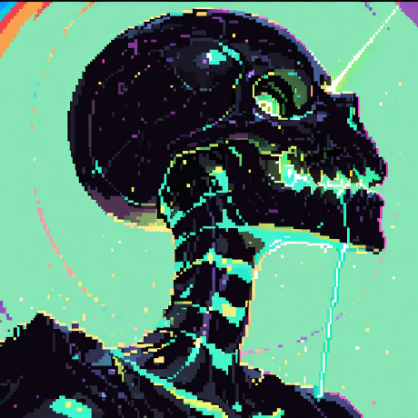

This file is a reference, not a real post. Its name starts with an underscore, so it stays out of the blog list, but you can open it at `blog/?p=_demo`. The opening paragraph of any post gets a drop cap and slightly larger text.

Ordinary paragraphs look like this one. You can use **bold**, *italics*, ~~strikethrough~~, `inline code` and [links](https://example.com), which turn into a solid block when hovered.

## Headings

A `##` heading gets the glossy title treatment and catches the light as it scrolls in.

### Smaller headings

A `###` heading is a quieter pixel label, for sections inside a section.

## Lists

- Unordered lists get square bullets
- They can be nested
  - like this
  - and this
- And carry on afterwards

1. Ordered lists get numbered badges
2. Which count up
3. As you would expect

- [x] Task lists work too
- [ ] With ticked and unticked boxes

## Code

Fenced code blocks become a small terminal window with a copy button. Name the language after the opening fence to get syntax colours.

```js
// doot.js
const SKELETONS = ['dan', 'becca'];

export function doot(times = 2) {
  const who = SKELETONS[Math.floor(Math.random() * SKELETONS.length)];
  return `${who} says ${'doot '.repeat(times).trim()}`;
}
```

```bash
scp my-new-post.md server:/srv/dootlord/posts/
```

## Quotes and callouts

> A plain blockquote grows a spine down its left edge.
> It is good for quoting people, or yourself.

> [!NOTE]
> Start a quote with `[!NOTE]` for a callout. Use it for asides.

> [!TIP]
> `[!TIP]` is green, for things worth trying.

> [!WARNING]
> `[!WARNING]` is orange, for things that bite.

> [!DOOT]
> `[!DOOT]` is purple and has a skull on it, for anything else.

## Images

An image on its own line is framed on a stack of rainbow layers that fans out on hover. The alt text becomes the caption.



## Tables

| Block       | Markdown        | Looks like          |
| ----------- | --------------- | ------------------- |
| Heading     | `## Title`      | Glossy pixel title  |
| Callout     | `> [!NOTE]`     | Coloured panel      |
| Divider     | `---`           | Bone, skull, bone   |

---

Three dashes on their own line make the divider above. That is everything.
